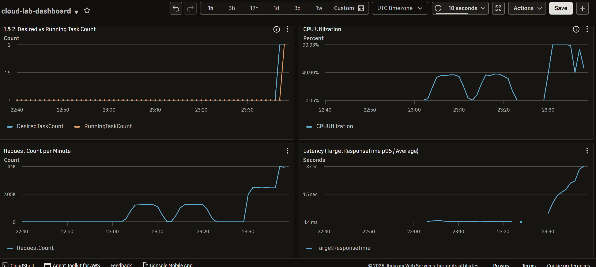

Навантажувальне тестування (Load Testing)

Інструмент
Для тестування використовувався інструмент k6. Сценарій імутує профіль «багато читань, мало записів» (співвідношення 1 запис до 9 читань).

Команда запуску
```bash
k6 run loadtest/script.js




  █ TOTAL RESULTS

    checks_total.......: 31640  52.7076/s
    checks_succeeded...: 90.00% 28476 out of 31640
    checks_failed......: 10.00% 3164 out of 31640

    ✗ status is 201
      ↳  0% — ✓ 0 / ✗ 3164
    ✓ status is 200

    HTTP
    http_req_duration..............: avg=1.13s  min=26.3ms   med=1.2s  max=3.23s  p(90)=2.19s  p(95)=2.72s
      { expected_response:true }...: avg=1.14s  min=39.91ms  med=1.21s max=3.23s  p(90)=2.2s   p(95)=2.72s
    http_req_failed................: 10.00% 3164 out of 31640
    http_reqs......................: 31640  52.7076/s

    EXECUTION
    iteration_duration.............: avg=11.45s min=530.18ms med=12.7s max=23.39s p(90)=19.03s p(95)=20.12s
    iterations.....................: 3164   5.27076/s
    vus............................: 1      min=1             max=100
    vus_max........................: 100    min=100           max=100

    NETWORK
    data_received..................: 12 MB  20 kB/s
    data_sent......................: 4.1 MB 6.8 kB/s


running (10m00.3s), 000/100 VUs, 3164 complete and 0 interrupted iterations
default ✓ [ 100% ] 000/100 VUs  10m0s